<div align="center">

# Cozy Nook — *Cocoa Delivery*

**A stylised 3D character and environment short made in Blender 5.2**

Two original characters, modelled, rigged, animated, lit and rendered,
living in a hand-dressed cut-away diorama home.

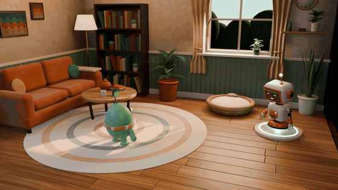

<sub>Preview GIF (reduced). Full-quality 1080p film: [`renders/anim/CozyNook_CocoaDelivery_1080p.mp4`](renders/anim/CozyNook_CocoaDelivery_1080p.mp4)</sub>

</div>

---

## The short

At sunset, **Pip** (a small sprout creature) watches the light through the living-room
window. Its robot housemate **Tock** wakes on its charging dock, glides across the room and
hands Pip a warm mug of cocoa. Pip hops with delight, waves, takes the mug, and sips it
contentedly.

**12.5 seconds · 300 frames @ 24 fps · 1920×1080 · one continuous camera move**

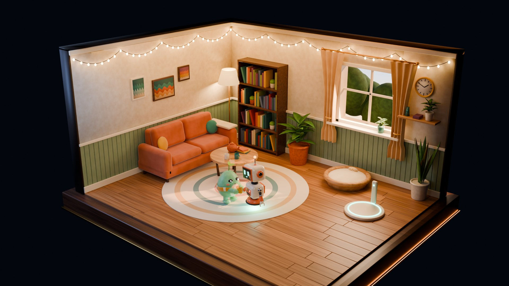

## Gallery

<table>
  <tr>
    <td>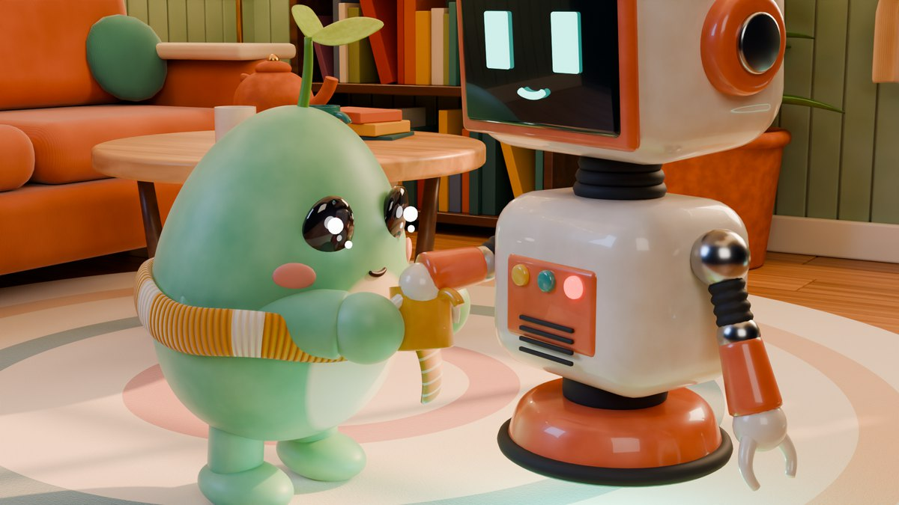</td>
    <td>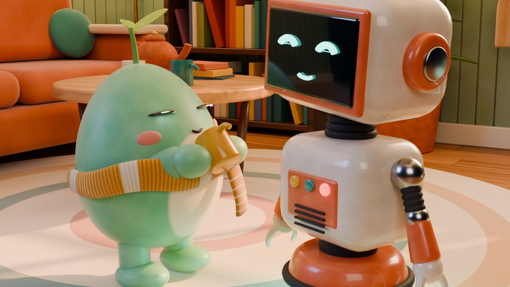</td>
  </tr>
  <tr>
    <td align="center"><sub>The hand-off (f220): constraint switch with no pop, Pip's hands on IK</sub></td>
    <td align="center"><sub>The sip: mug-driven IK arms, eyes-closed expression</sub></td>
  </tr>
  <tr>
    <td>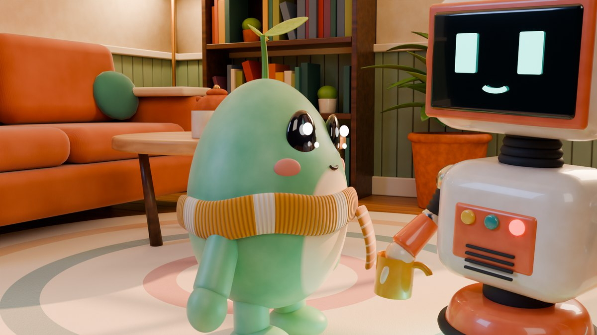</td>
    <td>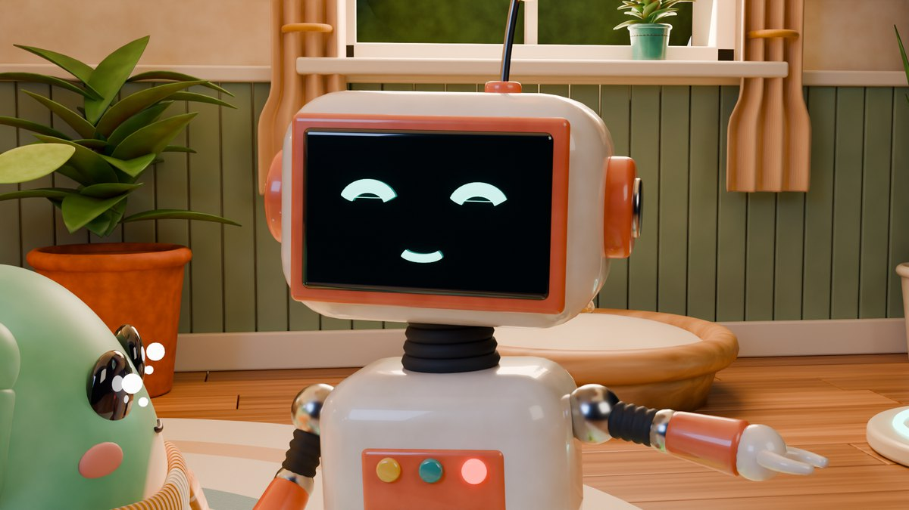</td>
  </tr>
  <tr>
    <td align="center"><sub>Pip: subsurface skin, rib-knit scarf, single-light catch-lights</sub></td>
    <td align="center"><sub>Tock: CRT face with expression bones (pill eyes ↔ happy arcs)</sub></td>
  </tr>
</table>

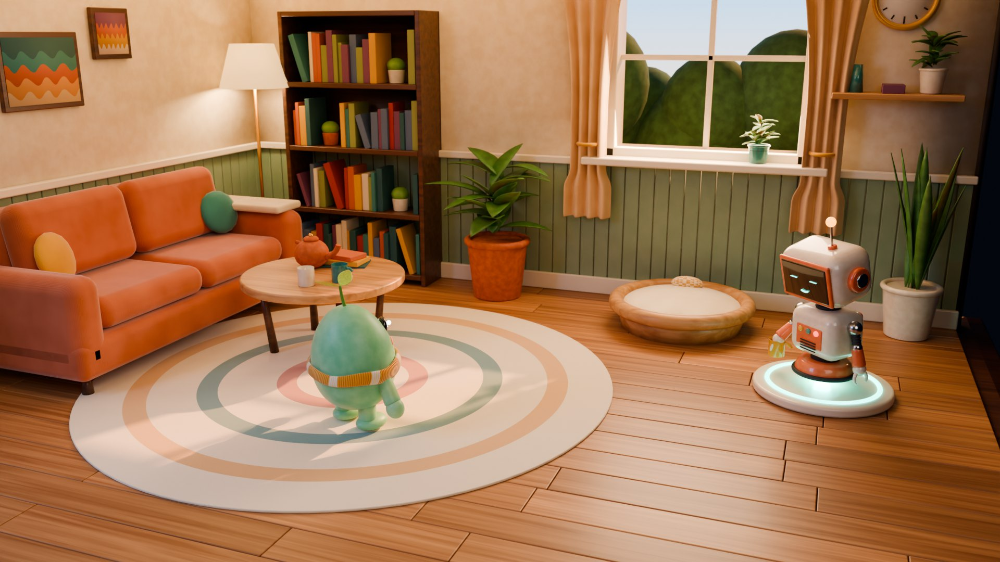

## Animation beats

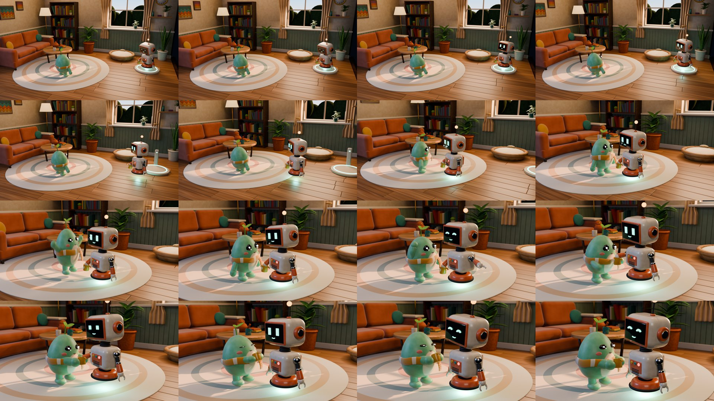

| Frames | Beat |
|---|---|
| 1–52 | Pip gazes out at the sunset. Tock wakes (eyes blink on, antenna jolts) and rises off its dock |
| 52–134 | Tock glides over, banking into the curve. The mug stays level in its counter-rotating hand |
| 100–176 | Pip notices: sprout perks, head-led turn, then an anticipation squash → stretch → landing hop |
| 176–222 | Pip waves, Tock's face goes happy. Tock offers the mug and Pip reaches for it |
| 222–300 | Hand-off, hug, sip and a contented sway |

Full beat sheet and camera plan: [`docs/SHOT_LIST.md`](docs/SHOT_LIST.md).

## Characters

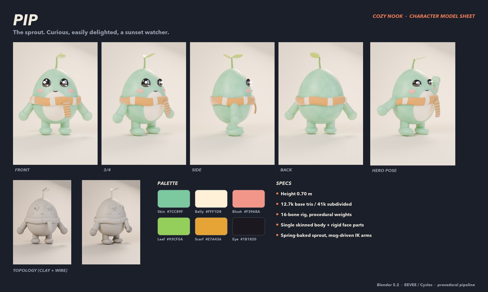

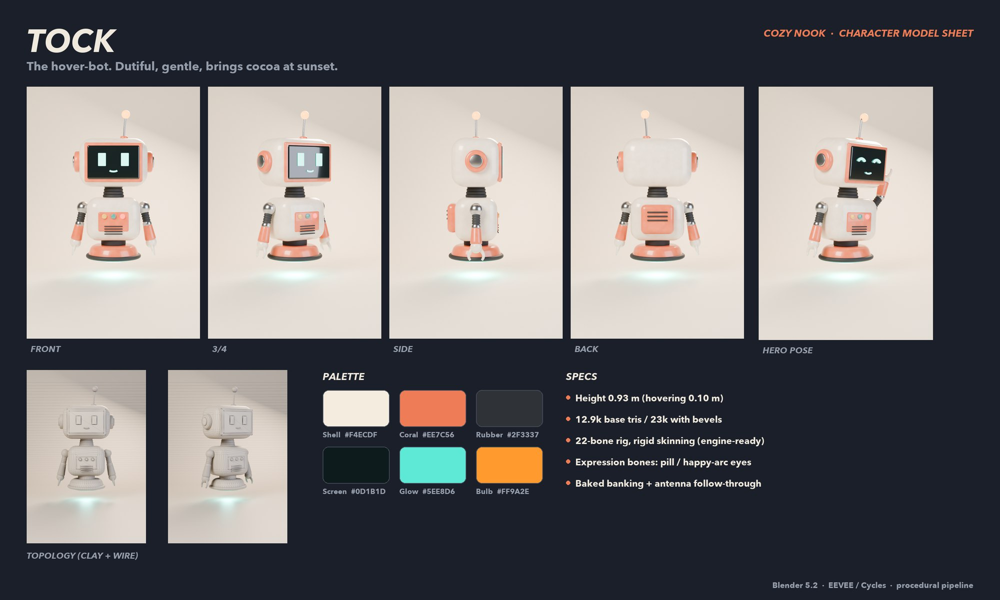

| | Pip | Tock |
|---|---|---|
| Role | Organic, skinned character | Hard-surface, rigid-skinned character |
| Height | 0.70 m | 0.93 m (hovers 0.10 m) |
| Geometry | 12.7k base tris / 41k subdivided | 12.9k base tris / 23k with bevels |
| Rig | 16 bones, procedural weights, FK + mug-driven IK | 22 bones, single-bone skinning, expression bones |
| Secondary motion | Spring-simulated sprout | Spring-simulated antenna and motion-driven banking |

Designs, palettes and acting notes: [`docs/CHARACTER_BIBLE.md`](docs/CHARACTER_BIBLE.md).

## Environment

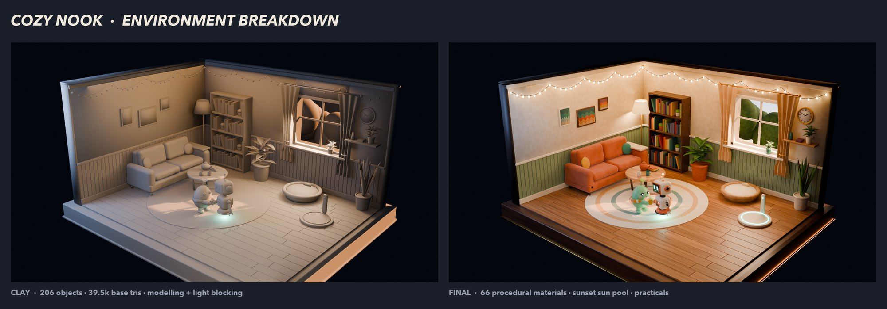

The cut-away living room is a single diorama, built at real-world scale (walls 2.6 m):

- 206 objects and 39.5k base tris (121k at render), with 66 procedural materials and
  **no image textures**.
- A plank floor with per-board colour variation driven by a colour attribute, beadboard
  wainscoting, curtains with a gathered drape, a stocked bookshelf, plants, a teapot set,
  fairy lights on catenary curves, and the characters' own furniture: Pip's basket bed and
  Tock's glowing charging dock.
- **Lighting.** A low sunset sun enters *only* through the window. Blockers that are hidden
  from the camera stand in for the missing ceiling and right wall, which puts a pool of
  light on the characters. Warm practical lights (floor lamp, fairy lights) set the mood, a
  cool rim light separates the silhouettes, and a soft key keeps faces readable.

## Technical highlights

- **Procedural skinning.** Pip's body, arms and legs form one mesh. Its weights come from
  smooth height and limb-axis falloffs, which gives clean squash and stretch with no hand
  painting. The face region belongs entirely to the head bone, so the eyes and mouth never
  swim on the surface.
- **Rest-position shading.** A `rest_pos` attribute keeps the belly patch and skin
  mottling fixed to Pip's skin while the body deforms.
- **Simulated secondary motion.** A damped spring is driven by each character's
  *evaluated* acceleration and baked to keys. It drives Pip's sprout and Tock's antenna
  follow-through and Tock's banking, so overlap always matches the primary timing.
- **Prop hand-off.** The mug has two `Child Of` constraints, Tock's hand and then a world
  hold control, with matched inverse matrices, so the switch has no pop. Pip's arms use
  2-bone IK whose targets ride on the mug, so the reach, hug and sip all follow the prop.
  A two-pass solve moves Tock's arrival point so the mug lands exactly in front of Pip's
  chest.
- **Staging for camera.** The characters stand on a line perpendicular to the lens, each
  turned about 40° toward camera. One camera with `Track To`, an animated focal length
  (32→44 mm) and depth of field pushes from the establishing shot into the two-shot.
- **Engine-ready exports.** Pip and Tock are exported as glTF and FBX with one clip each
  (`Pip_CocoaDelivery`, `Tock_CocoaDelivery`), and the round-trip import is verified.

## Built to production standards

| Area | Standard |
|---|---|
| Scale and axes | Metres, +Z up, −Y front, `.L` = character left (+X) |
| Naming | `CH_` `RIG_` `ENV_` `PROP_` `MAT_` `LGT_` `CAM_` `WGT_` prefixes, `.L/.R` suffixes |
| Organisation | ENV / CH / PROP / LGT / CAM / WGT collections, prop roots as empties |
| Modifier stack | Armature → Bevel/Solidify → Subdivision |
| Rigging | Armature-modifier skinning (no bone-parented meshes), custom widgets, colour-coded sides, quaternion rotations |
| Rendering | AgX Medium High Contrast. EEVEE (ray-traced GI, motion blur) for animation, Cycles (Metal GPU, denoised) for stills |

Full conventions: [`docs/STANDARDS.md`](docs/STANDARDS.md).

## Reproducible pipeline

Every mesh, material, rig, keyframe, light and camera is generated by Python, so the
master `.blend` can be rebuilt from scratch at any time:

```bash
make all          # scene → animation → movie → stills → clay → turnarounds → sheets → exports
make scene        # regenerate blend/CozyNook_Master.blend only
make review       # quick contact sheet of the story beats
```

```
scripts/
├── build_scene.py            build and save the master scene
├── render_stills.py          Cycles portfolio stills (+ clay pass)
├── render_turnaround.py      model-sheet renders (beauty / posed / wireframe)
├── render_contact_sheet.py   animation review sheets
├── make_sheets.py            compose model sheets and the breakdown (Pillow)
├── export_assets.py          glTF / FBX export
└── cozy/
    ├── utils.py              bmesh primitives, tube sweeps, modifiers, animation helpers
    ├── materials.py          procedural shader library
    ├── environment.py        architecture, furniture, props, set dressing
    ├── rig.py                armature builder, skinning, widgets, pose-space keying
    ├── char_pip.py           Pip: model, materials, skeleton, weights
    ├── char_tock.py          Tock: model, materials, skeleton, expressions
    ├── animation.py          blocking, secondary-motion sim, hand-off, camera
    └── lighting.py           light rig, world, cameras, render presets
```

## Repository contents

| Path | What |
|---|---|
| `blend/CozyNook_Master.blend` | Master scene: open it in Blender 5.2+ and press Space to play |
| `renders/anim/` | Final 1080p film (H.264) |
| `renders/stills/` | Cycles stills plus a clay pass |
| `renders/turnarounds/` | Front / ¾ / side / back, posed, and wireframe renders |
| `renders/sheets/` | Model sheets and environment breakdown |
| `exports/` | `Pip.glb/.fbx`, `Tock.glb/.fbx`, `CozyNook_Env.glb` |
| `docs/` | Standards, character bible, shot list |

**Tools:** Blender 5.2 LTS (modelling, rigging, animation, EEVEE, Cycles), Python
(`bpy`, `bmesh`), FFmpeg, Pillow.
